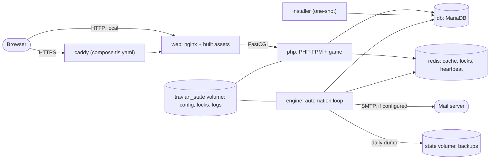

# Architecture

| Service | Image | Role |
| --- | --- | --- |
| `web` | `opentravian-web` | nginx: static files and Gpack, rate limits, host allow-list, FastCGI to `php`. Only service that publishes a port |
| `php` | `opentravian-app` | PHP-FPM running `game/` and the setup wizard |
| `engine` | `opentravian-app` | Long-running automation loop (`game/deployment/include/Automation.php`): construction, movements, training, the mail queue worker, scheduled backups. Waits for `setup.lock` |
| `db` | `mariadb` | Two databases: account (`travian_main`) and world (`travian_world`). Private |
| `redis` | `redis` | Cache, locks and the engine heartbeat. Private |
| `caddy` | `caddy` | Optional (`compose.tls.yaml`): automatic HTTPS in front of `web` |
| `installer` | `opentravian-app` | One-shot: runs `tools/install.php` on `docker compose up` (a no-op unless an install is requested) and on `docker compose run --rm installer`. The only service that gets the database administrator password |

State that must survive: the `mariadb_data` volume (the databases) and the `travian_state` volume (generated config, `setup.lock`, SMTP credentials, sessions, logs, backups). Both are removed by `docker compose down -v`.

One installer serves two entry points. `game/include/Game/Installer/` parses and validates an install request (`InstallInput`) and runs it (`WorldInstaller`); the setup wizard (`game/deployment/public/setup.php`) and the CLI (`tools/install.php`) both call it, so they cannot drift apart.

The game pack served to the browser is `assets/gpack/travian/mainPage/`.

The `php` image runs PHP 8.5 with the extensions the game uses (gd, intl, mysqli, pcntl, pdo_mysql, redis). MariaDB 11.4 and Redis 7 are private Compose services and publish no host port.
